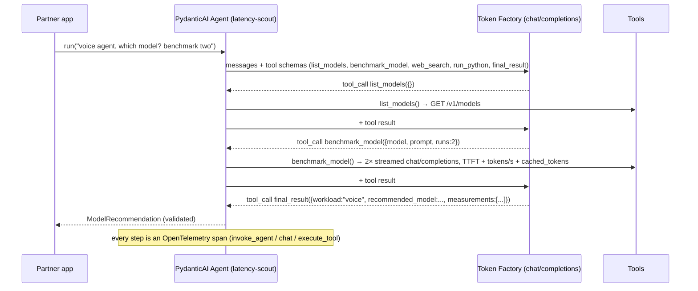

# Architecture

## The agent loop

## Decisions and why

| Decision | Alternative | Why this one |
|---|---|---|
| Structured output via a `final_result` **tool** by default | `response_format: json_schema` | Needs only tool calling, which every agent-capable open model has; `native` is one flag away and the kit checks whether the model supports it |
| No `strict: true` on tool definitions | OpenAI strict mode | Open-model servers reject or ignore it; profile sets `openai_supports_strict_tool_definition=False` |
| `max_tokens`, not `max_completion_tokens` | OpenAI's newer field | vLLM-style servers honour `max_tokens` |
| `reasoning_content` as the thinking field | `reasoning` | DeepSeek and most vLLM reasoning parsers use it; harmless for models that don't think |
| Prefix-cache aware (`supports_auto_cache`) | ignore cache | Token Factory reports `prompt_tokens_details.cached_tokens`; the agent's usage shows `cache_read` so partners see the saving |
| File exporter as the default trace sink | console / OTLP | A partner can `jq` a trace with no backend; OTLP is one env var away |
| Mock server that honours schemas | record/replay cassettes | Cassettes break on every prompt change; a schema-driven fake keeps CI green and still exercises the real wire protocol |
| Benchmark tool streams | non-streaming timing | TTFT is only observable with streaming, and TTFT is what voice partners buy |

## Runtime on Nebius

See the diagram in the README. The three Nebius-specific choices:

1. **Dedicated endpoint** for the partner model (`NEBIUS_BASE_URL`), so TTFT and tokens/s are contractual. Shared Token Factory endpoints are fine for development and for the conformance kit.
2. **Managed Kubernetes** for the stateless agent service (`deploy/k8s.yaml`), HPA on CPU; the pods hold no conversation state.
3. **Langfuse self-hosted on the same cluster** receiving OTLP, so traces → datasets → evals → post-training on Token Factory is one network hop. Langfuse Cloud works with the same two env vars.

## Failure modes we designed for

* Model emits a tool call with malformed JSON → PydanticAI retries with the validation error (`retries=2`); the kit's `tools.call_emitted` catches it earlier.
* Model calls the tool again instead of answering → `tools.result_roundtrip` reports PARTIAL; the agent's `instructions` ask for an answer after measurement.
* `response_format: json_schema` unsupported for a model → `native` mode fails validation; use `tool` mode (default). The kit tells you first.
* Streaming tool-call deltas split mid-JSON → reassembled by index in both the framework and `streaming.tool_call_deltas`.
* Sandbox not configured → `run_python` returns a clear message instead of executing locally; local exec is opt-in.
